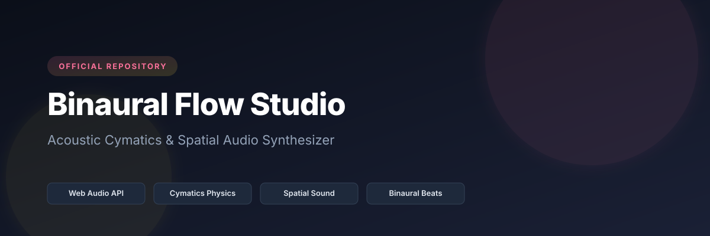
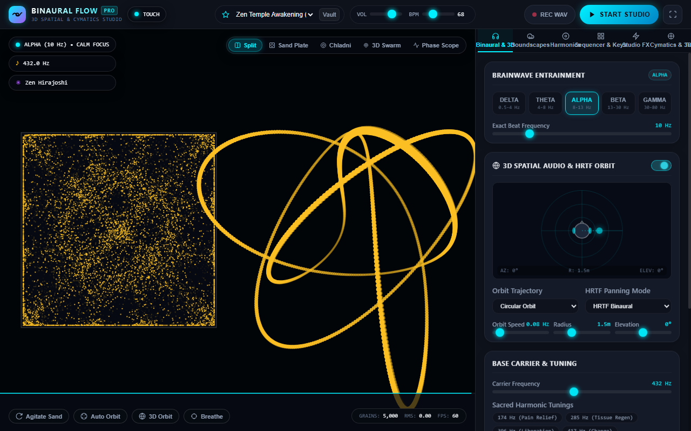
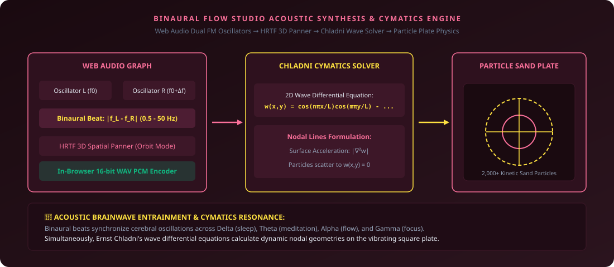

# Binaural Flow Studio
### Acoustic Cymatics & Spatial Audio Synthesizer



[](https://developer.mozilla.org/en-US/docs/Web/API/Web_Audio_API)
[]()
[]()
[]()
[]()

---

## 📸 Live Application Interface


*Figure 1: Binaural Flow Studio running live — generating binaural beat drones with real-time 2D Chladni sand plate resonance patterns and 3D Lissajous particle fields.*

---

## 🌟 Overview

**Binaural Flow Studio** is an advanced generative audio visualizer and acoustic synthesis laboratory. Powered by the native **Web Audio API**, it synthesizes pure polyphonic soundscapes, binaural brainwave frequencies (Alpha, Theta, Delta, Gamma), and 3D spatial orbit audio.

Simultaneously, an internal physics solver simulates **Chladni plate cymatics** — modeling how thousands of sand particles scatter away from vibrating anti-nodes and settle into complex geometric nodal lines under varying harmonic frequencies.

---

## 🔬 Acoustic & Physical Principles



### 1. 2D Chladni Cymatics Formula
Vibration patterns on a square plate of side length $L$ fixed at the center obey the 2D acoustic wave differential solution:
$$w(x, y) = a \cos\left(\frac{n \pi x}{L}\right) \cos\left(\frac{m \pi y}{L}\right) - b \cos\left(\frac{m \pi x}{L}\right) \cos\left(\frac{n \pi y}{L}\right) = 0$$

Where $m$ and $n$ represent spatial harmonic modes. Particles experience kinetic repulsion proportional to the local surface acceleration $|\nabla^2 w|$, causing them to naturally congregate along zero-displacement nodal boundaries.

### 2. Binaural Brainwave Entrainment
By presenting slightly offset frequencies to the left and right ear channels ($f_L$ and $f_R$), the brain perceives an auditory beat frequency:
$$f_{\text{beat}} = |f_L - f_R|$$

| Wave State | Frequency Range | Psychological Target |
|---|---|---|
| **Delta** ($\delta$) | 0.5 – 4.0 Hz | Deep restorative sleep, unconscious healing. |
| **Theta** ($\theta$) | 4.0 – 8.0 Hz | Deep meditation, hypnagogic creativity, memory consolidation. |
| **Alpha** ($\alpha$) | 8.0 – 13.0 Hz | Flow state, calm alertness, stress reduction. |
| **Beta** ($\beta$) | 14.0 – 30.0 Hz | Active focus, problem solving, analytical thought. |
| **Gamma** ($\gamma$) | 30.0 – 50.0 Hz | High-level cognitive processing, peak awareness. |

### 3. 3D Spatial Audio & Orbit Mode
Utilizes the Web Audio `PannerNode` with **HRTF (Head-Related Transfer Function)** panning. In Orbit Mode, ambient sound sources rotate in an adjustable 3D elliptical sphere around the listener's head.

---

## 🎹 Studio Features
- **In-Browser WAV Exporter**: Records and encodes the master audio stream into an uncompressed 16-bit 44.1kHz stereo WAV file directly in memory.
- **Ambient Multi-Layer Mixer**: Blend organic rain, deep cosmic pink/brown noise, and Tibetan singing bowl resonances behind harmonic drone chords.
- **Touch Piano Keyboard**: On-screen microtonal and pentatonic keyboard with velocity sensitivity for live melody generation.
- **Breathing Guide & Sleep Timer**: Integrated visual pacer for box breathing meditation with gradual volume fadeout.

---

## 🚀 How to Run

1. Clone repository:
```bash
git clone git@github.com-podev:pushpikaodisha/binaural-flow-studio.git
cd binaural-flow-studio
```
2. Open **`index.html`** in any web browser with headphones for full binaural immersion.
3. No build step or installation required.

---

## 👤 Author & Maintainer
- **Engineer**: Pushpika Odisha
- **Email**: pushpikaodisha.dev@gmail.com
- **GitHub**: [@pushpikaodisha](https://github.com/pushpikaodisha)
